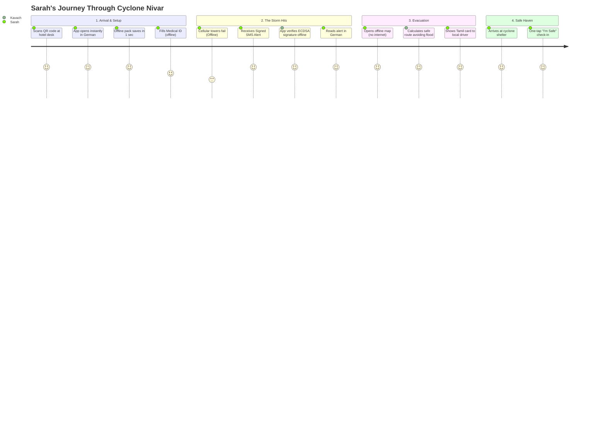
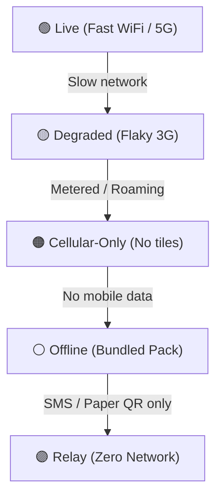
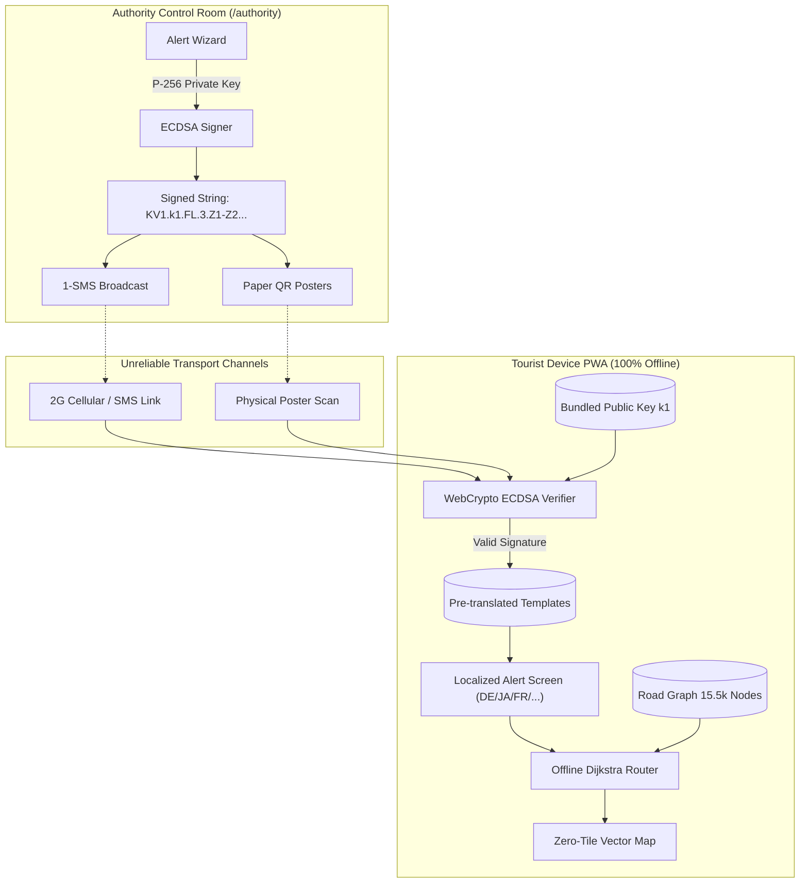

<div align="center">

# 🛡️ Kavach · कवच
### Real-Time Crisis Communication for Foreign Tourists During Extreme Weather Events

**When the cell towers collapse and the internet dies, vital safety information must still arrive, be cryptographically verifiable, and be understandable in the tourist's native language.**

`Hackathon Track: TravelTech` · **Pilot Region: Mamallapuram (Mahabalipuram) & Chennai Coastal Corridor, Tamil Nadu, India**

[](https://kavach.pages.dev)
[](https://kavach.pages.dev)
[](https://kavach.pages.dev)
[](https://kavach.pages.dev)
[](./DISCLOSURES.md)

</div>

---

## 📖 Table of Contents
1. [The Crisis: Why Foreign Tourists Suffer Most](#-the-crisis-why-foreign-tourists-suffer-most)
2. [The Core Solution: 5 Inviolable Guarantees](#-the-core-solution-5-inviolable-guarantees)
3. [The Foreign Tourist Journey: A Complete Step-by-Step Scenario](#-the-foreign-tourist-journey-a-complete-step-by-step-scenario)
4. [Connectivity Ladder: Graceful Degradation](#-connectivity-ladder-graceful-degradation)
5. [The System Architecture & Technical Breakthroughs](#-the-system-architecture--technical-breakthroughs)
6. [Feature Breakdown by Route](#-feature-breakdown-by-route)
7. [Authority Console: Crisis Management Room](#-authority-console-crisis-management-room)
8. [Data Strategy & Content Pack](#-data-strategy--content-pack)
9. [Getting Started & Local Verification](#-getting-started--local-verification)
10. [Trust & Ethical Guardrails](#-trust--ethical-guardrails)

---

## 🌊 The Crisis: Why Foreign Tourists Suffer Most

During extreme weather events (such as Cyclone Vardah, Cyclone Michaung, or the Chennai flash floods), international tourists are in extreme danger:
1. **Zero Geographic Knowledge**: Foreign travellers do not know local flood basins, topography, low-lying backwaters, or which streets turn into torrents.
2. **Severe Language Barriers**: Local government announcements, loudspeakers, and TV broadcasts are in Tamil or Hindi. Tourists cannot read signage or comprehend emergency warnings.
3. **Infrastructure Collapse**: When power grids trip and mobile data fails, tourists cannot use Google Maps, Uber, or translation apps.
4. **Disinformation & Panic**: Without official verified information, tourists fall back on unverified social media rumours and walk directly into flooded danger zones.
5. **App Store Friction**: Expecting a panicked tourist in a storm to download a 200 MB native app from an app store over a failing cellular connection is unrealistic.

---

## 💡 The Core Solution: 5 Inviolable Guarantees

Kavach is a **zero-install, offline-first Progressive Web App (PWA)** that loads in seconds from a physical QR code at hotel lobbies, airports, and taxis, and continues functioning across all 5 levels of connectivity.

```
       ┌─────────────────────────────────────────────────────────────┐
       │                 KAVACH 5 CORE GUARANTEES                    │
       ├──────────────────────────────┬──────────────────────────────┤
       │ 1. Signed Alert Packets      │ ECDSA P-256 verified offline │
       │ 2. Universal Alert Codes     │ Renders in 8 languages       │
       │ 3. Connectivity Ladder       │ Live → Degraded → Offline    │
       │ 4. Grounded AI Assistant     │ Never hallucinates shelters  │
       │ 5. Hazard-Aware Routing      │ Offline maps avoiding floods │
       └──────────────────────────────┴──────────────────────────────┘
```

| # | Innovation | What it Does |
|---|---|---|
| **1** | **Signed Alert Packets** | Every official alert is signed with an **ECDSA P-256** key and compressed to under **140 characters**. It fits in **one standard SMS** or **one small QR code** and is verified **100% offline** on the user's phone using a bundled public key. |
| **2** | **Language-Independent Alert Codes** | The packet only transmits codes (e.g. `KV1.k1.FL.3.Z1-Z2...`). The tourist's device decodes and displays the full emergency instructions from pre-translated templates stored in memory across **8 languages** (`EN`, `TA`, `HI`, `FR`, `DE`, `AR`, `ZH`, `JA`). |
| **3** | **Connectivity Ladder** | The app actively senses network quality (`Live` → `Degraded` → `Cellular-only` → `Offline` → `Relay`) and adapts features dynamically while keeping a visible status chip on screen. |
| **4** | **Grounded Crisis Assistant** | Provides life-saving guidance using local BM25 MiniSearch and deterministic decision trees when offline, and edge-proxied LLMs when online. **It never invents or hallucinates shelters, numbers, or medical advice.** |
| **5** | **Zero-Tile Hazard Routing** | Built-in road graph (15,500+ nodes) computes walking routes to verified shelters while dynamically avoiding flooded/flagged zones—with an offline compass fallback. |

---

## 🌍 The Foreign Tourist Journey: A Complete Step-by-Step Scenario

Here is how **Sarah**, a solo traveller from Germany visiting the UNESCO heritage temples in Mamallapuram, uses Kavach before, during, and after a Category 3 Cyclone:



### Stage 1: Arrival & Zero-Install Onboarding (Hotel Wi-Fi)
1. **At Hotel Reception**: Sarah spots a small desk stand: *"Kavach Tourist Safety Portal — Scan for Offline Crisis Guidance"*.
2. **Instant Open**: Sarah scans the QR code with her phone camera. The PWA opens instantly in her browser at `http://localhost:5173/` (or production URL).
3. **No App Store**: No account creation, no password, and no app store download required.
4. **Preloaded Safety Pack**: In under 1.5 seconds, the browser caches the entire **848 KB content pack** (Mamallapuram road network, shelter locations, hospitals, first-aid knowledge base, phrasebooks, and 8-language alert templates) via Service Worker and IndexedDB.
5. **Language Selection**: Sarah switches the language to **German (Deutsch)**. The entire interface adapts instantly.
6. **Medical ID**: Sarah fills out her optional Medical ID (Allergies: Penicillin, Blood Group: O+, Emergency contact). **This data stays 100% on Sarah's phone and is never uploaded.**

---

### Stage 2: The Cyclone Strikes — Network Drops to Zero
1. **Power Outage & Cell Tower Failure**: Heavy rain causes power lines and 4G base stations to fail. Sarah's phone loses mobile internet.
2. **Connectivity Status Chip**: The status chip in Kavach immediately flips from `Live` (green) to **`Offline` (grey)** or **`Relay` (amber)**.
3. **Signed SMS Broadcast**: Even when 4G data is dead, 2G SMS text channels still operate. The Tamil Nadu Disaster Management Authority (TNDMA) broadcasts a compact 120-character signed SMS alert link:
   ```text
   Kavach Alert: /#/a/KV1.k1.CY.3.Z1-Z2.1p4q.1p8s.1.D.MEQCIC...
   ```
4. **Offline Cryptographic Verification**:
   - Sarah taps the link (or scans a paper QR poster in her hotel corridor).
   - Kavach parses the payload and verifies the **ECDSA P-256 signature** against the bundled public key using standard browser WebCrypto.
   - **Result**: The app displays a green **"ECDSA Verified"** badge. Sarah knows with 100% mathematical certainty that this alert is genuine and not a panic rumour.
5. **Instant German Translation**:
   - The device sees code `CY` (Cyclone), level `3` (Warning), zones `Z1-Z2` (Seafront & Lowlands).
   - It renders the preloaded German template:
     > **"Offizielle Zyklon-Warnung (Stufe 3) für Mamallapuram Strandbereich. Sofort landeinwärts in feste Notunterkünfte begeben."**

---

### Stage 3: Hazard-Aware Evacuation (Zero Map Tiles)
1. **Navigating to Safety**: Sarah opens the **Map** tab (`/#/map`). Even with zero map tiles downloaded, Kavach renders the high-contrast offline vector map:
   - **Red/Hatched Polygons**: Zone 1 (Seafront) and Zone 2 are highlighted as active flood hazards.
   - **Shield Icons**: High-ground cyclone shelters.
   - **Cross Icons**: Emergency clinics and hospitals.
2. **Smart Offline Routing**: Sarah taps the nearest shelter (*"Mamallapuram Government Higher Secondary School Shelter"*).
   - Kavach's client-side Dijkstra engine computes a walking path that **strictly routes around the flooded coastal zones**.
   - Note displayed: *"About 12 min on foot. The route avoids flagged hazard zones."*
3. **Compass Fallback**: In dense rain or obstructed visibility, Sarah taps **Compass**. A rotating full-screen compass points her directly toward the shelter with deterministic guidance: *"Head roughly north-west, 650 m"*.

---

### Stage 4: Overcoming the Language Barrier with Locals
1. **Meeting a Local Resident**: On her way, Sarah encounters a local shopkeeper with a vehicle but cannot speak Tamil.
2. **Show-a-Local Phrasebook** (`/#/phrases`): Sarah opens the Phrasebook and selects *"I need shelter from the cyclone"*.
3. **Large Display & Text-to-Speech**:
   - The phone displays large, clear Tamil script:
     > **எனக்கு புயல் பாதுகாப்பு முகாம் எங்குள்ளது என்று சொல்ல முடியுமா?**
   - Sarah taps **Read Aloud** — the phone speaks the Tamil sentence audibly.
   - The local driver immediately understands and directs her safely to the shelter.

---

### Stage 5: Emergency SOS & "I'm Safe" Check-In
1. **One-Tap Emergency Call**: If injured, Sarah opens **SOS** (`/#/sos`) to view her exact GPS coordinates (22px high-contrast typography) with one-tap speed dial for **112 (National Emergency)** and **108 (Ambulance)**.
2. **Pre-Formatted SMS to Embassy/Family**: Sarah taps *"Send Emergency SMS"*. Kavach generates an emergency text with her exact coordinates and battery level, ready to send over basic 2G SMS.
3. **"I'm Safe" Check-in**: Sarah marks herself as safe in the shelter. The update is saved to the **Offline Outbox** and automatically syncs to the TNDMA dashboard as soon as signal momentarily flickers.

---

## 📶 Connectivity Ladder: Graceful Degradation

Kavach is designed around a 5-rung connectivity ladder. The app **never displays a dead blank screen or infinite spinner**:



| Rung | Connectivity State | Kavach Behavior |
|---|---|---|
| **🟢 Live** | Fast Wi-Fi / 5G | Full live risk updates, real-time authority sync, online Gemini AI assistant, live background outbox sync. |
| **🟡 Degraded** | High latency / packet loss | Aggressive timeouts with retries, cached risk snapshots, graceful fallback to on-device search. |
| **🟠 Cellular-Only** | Metered tourist eSIM / Roaming | Pauses heavy satellite map tiles and video assets; text, compressed vector roads, and QR codes only. |
| **⚪ Offline** | Airplane mode / Power failure | 100% functional from bundled 848 KB pack: offline vector maps, road routing, MiniSearch KB, Medical ID. |
| **🟣 Relay** | Zero data (SMS/Voice only) | Decodes signed packets handed over by SMS link or paper QR poster; show-a-local card display and TTS. |

---

## 🏛️ Authority Console: Crisis Management Room

The **Authority Console (`/#/authority`)** is a desktop-first command center for disaster management officials (TNDMA) to issue cryptographically signed crisis warnings and monitor civilian safety.

```
┌─────────────────────────────────────────────────────────────────────────────────────────────┐
│  KAVACH AUTHORITY CONSOLE   [ DRILL MODE · 演習 ]   Signed in: Control Room (TNDMA)  [Sign Out] │
├──────────────────────────┬──────────────────────────────────────────────────────────────────┤
│ 🚩 Create Alert          │ STEP 3 OF 4: REVIEW & TRANSLATION PREVIEW                        │
│ 📡 Active Alerts (2)     │ ─────────────────────────────────────────────────────────────── │
│ 📜 History Ledger        │ Hazard: FLOOD (FL)  ·  Level: LEVEL 3 (WARNING)  ·  Zones: Z1, Z2│
│ 📢 Community Reports (3) │ Preview in 8 Languages: [EN] [TA] [HI] [FR] [DE] [AR] [ZH] [JA]  │
│ 👥 Zone Check-ins (154)  │ "Offizielle Hochwasser-Warnung für Zone(n) Strandbereich..."     │
│                          │ Payload: KV1.k1.FL.3.Z1-Z2.[issued].[expires].[seq].D (121 chars)│
│                          │ [◀ Back: Zones]                    [▶ Sign & Broadcast Alert]     │
└──────────────────────────┴──────────────────────────────────────────────────────────────────┘
```

### 1. 4-Step Alert Issuance Wizard
- **Step 1 (Hazard & Level)**: Radio cards with plain-language descriptions (Advisory $\rightarrow$ Watch $\rightarrow$ Warning $\rightarrow$ Emergency) and duration presets (1h, 2h, 4h, 12h, 24h).
- **Step 2 (Target Zones)**: Interactive zone selector with real-time risk status tags.
- **Step 3 (Review & 8-Language Previews)**:
  - Tabbed preview showing the exact rendered alert cards for all 8 languages.
  - Payload preview with byte budget counter (guaranteed under 140 chars for single-SMS delivery).
  - Mode toggle (`Drill` vs `Live`). Selecting `Live` triggers a strict confirmation dialog requiring the operator to confirm the exact zone count.
- **Step 4 (Sign & Broadcast)**: Signs with ECDSA P-256 private key. Generates shareable SMS links, pure SVG QR codes, and **Printable Evacuation Posters** (`@media print` stylesheet).

### 2. Live Management & Superseding Rules
- **Countdown Ticker**: Real-time timer showing exact time until alert expiration.
- **Extend (+2h)**: Issues a new sequence packet extending shelter duration.
- **Escalate (+1 Level)**: Rapidly upgrades Watch to Warning.
- **Cancel Alert**: Issues a **Level 0 / All-Clear (`AC`)** packet with a higher sequence number. The tourist app's `alertState` engine automatically supersedes and clears the warning.

### 3. Historical Audit Ledger
- Auditable ledger of all past broadcasts with **in-browser offline ECDSA re-verification** confirming signature integrity.

---

## ⚙️ The System Architecture & Technical Breakthroughs



### 1. Compact Cryptographic Packet Specification (`KV1`)
The packet format is dot-separated base36 for minimal byte overhead:
```
KV1 . <kid> . <hazard> . <level> . <zones> . <issuedMin> . <expiresMin> . <seq> . <mode> . <sig>
```
- `KV1`: Protocol version 1.
- `kid`: Key ID in registry (`k1`).
- `hazard`: Hazard code (`FL`, `CY`, `HT`, `WN`, `LS`, `AC`).
- `level`: Alert severity (`0` = All-Clear to `4` = Extreme Emergency).
- `zones`: Hyphenated zone IDs (`Z1-Z2`).
- `issuedMin` / `expiresMin`: Base36 Unix minutes timestamp.
- `seq`: Base36 sequence number for superseding old alerts.
- `mode`: `L` (Live broadcast) or `D` (Drill watermarked).
- `sig`: 64-byte raw IEEE P1363 ECDSA signature, base64url encoded (86 chars, no padding).

### 2. Zero-Tile Offline Vector Engine
Rather than relying on multi-gigabyte raster or vector map tile downloads that fail during a crisis, Kavach bundles a lightweight **785 KB topologically indexed road graph** of the pilot area:
- Custom SVG canvas renderer draws roads, coastline, and polygons directly from IndexedDB.
- Client-side A*/Dijkstra algorithm executes in `< 25ms` inside a Web Worker.
- Automatically marks flagged flood hazard zones as impassable polygons.

---

## 📱 Feature Breakdown by Route

| Route | Feature | Offline Capability |
|---|---|---|
| `/#/` | **Home / Status Dashboard** | Displays active zone risk meter (Level 0–4), connectivity status chip, quick safety actions, and offline promises. |
| `/#/alerts` | **Verified Alerts Inbox** | Shows verified emergency broadcasts with ECDSA verified badge, drill labels, age tickers, and language-translated steps. |
| `/#/a/:packet` | **Signed Packet Deep Link** | Instant standalone packet decoder and offline verifier for SMS links and QR scans. |
| `/#/map` | **Offline Map & Routing** | Zero-tile vector map, shelter/hospital markers, hazard zones, route generator, and full-screen Compass. |
| `/#/assist` | **Crisis Assistant** | Grounded safety guidance using MiniSearch BM25 over first-aid docs & decision trees (never hallucinates). |
| `/#/sos` / `/#/aid` | **One-Tap SOS & Aid** | High-contrast GPS coordinates, one-tap calling (112/108), and pre-formatted emergency SMS generator. |
| `/#/phrases` | **Show-a-Local Phrasebook** | 40 essential crisis phrases with large Tamil script display and Text-to-Speech (TTS) audio read-aloud. |
| `/#/me` | **Medical ID & Settings** | Local-only medical profile, offline emergency lock-screen QR generator, and WebGPU offline AI model settings. |
| `/#/authority` | **Authority Console** | Official control room for signing alerts, active alert management, and printable QR posters. |

---

## 📦 Data Strategy & Content Pack

The content pack in `public/pack/` (~848 KB total) is generated from OpenStreetMap and verified government data:

| File | Size | Contents |
|---|---|---|
| `places.json` | 17 KB | 63 verified emergency places (shelters, clinics, hospitals, police, pharmacies). |
| `roads.json` | 785 KB | 15,599 nodes, 18,292 edges (94% strongly connected road network for Mamallapuram). |
| `zones.geojson` | 7 KB | 9 pilot alert zones (`Z1` to `Z9`) with flood-prone metadata. |
| `contacts.json` | 2 KB | Emergency helplines (112, 108, 1070, 100, 101, 1363) and foreign consulates. |
| `templates/*.json` | 72 KB | Pre-translated emergency instructions in 8 languages for 6 hazard types. |
| `kb/*.json` | 80 KB | First-aid guidance, CPR instructions, cyclone checklists, and search indices. |
| `phrases/*.json` | 56 KB | Show-a-local phrase cards with Tamil phonetic transliteration. |

---

## 🚀 Getting Started & Local Verification

### 1. Installation & Running Locally
```bash
# Clone the repository
git clone https://github.com/karthiktotad/kavach.git
cd kavach

# Install dependencies
npm install

# Start development server
npm run dev
```
Open **[http://localhost:5173/](http://localhost:5173/)** in your browser.

---

### 2. Testing the Authority Console & Tourist Alert Flow
1. Open **[http://localhost:5173/#/authority](http://localhost:5173/#/authority)**.
2. Click **`Demo Authority (Judge Access · Drill-Only)`** (or sign in with your email).
3. Complete the 4-step wizard to sign and broadcast a **Flood Level 3 Warning for Zone 1**.
4. Click **`Print QR poster`** to inspect the printable evacuation poster.
5. Open **[http://localhost:5173/#/alerts](http://localhost:5173/#/alerts)** in another tab — see the alert immediately appear with its **ECDSA Verified Badge**!
6. Open **[http://localhost:5173/#/map](http://localhost:5173/#/map)** — see Zone 1 highlighted as a flood hazard and test routing to the nearest shelter.

---

### 3. Automated Quality & Security Verification
Run the complete suite of quality gates:
```bash
# Run all 41 test files (368 unit & integration tests)
npm test

# Typecheck TypeScript (strict mode)
npm run typecheck

# Lint with ESLint
npm run lint

# Build production bundle with Service Worker
npm run build
```

---

## 🔒 Trust & Ethical Guardrails

1. **No Hallucinated Safety Data**: Safety-critical facts (shelter coordinates, telephone numbers, medical instructions) are strictly deterministic and loaded from verified content packs or signed packets—never generated on-the-fly by an LLM.
2. **Community vs Official Segregation**: Community hazard reports are clearly badged with trust confidence scores and are **never styled as official alerts**.
3. **Transparent Drill Labelling**: Non-emergency simulations are prominently watermarked as **`DRILL · 演習`** in the UI and inside the cryptographic packet payload. Nothing simulated is ever presented as real.
4. **Zero Cloud Leakage for Medical Data**: Personal Medical ID profiles are stored exclusively on-device in IndexedDB and are never sent over the network.
5. **Open & Attributed**: All open-source libraries, APIs, and datasets are documented in [`DISCLOSURES.md`](./DISCLOSURES.md).

---

<div align="center">
<b>Kavach · Built for Hackathon Excellence · Free Tier & Offline Resilient</b>
</div>