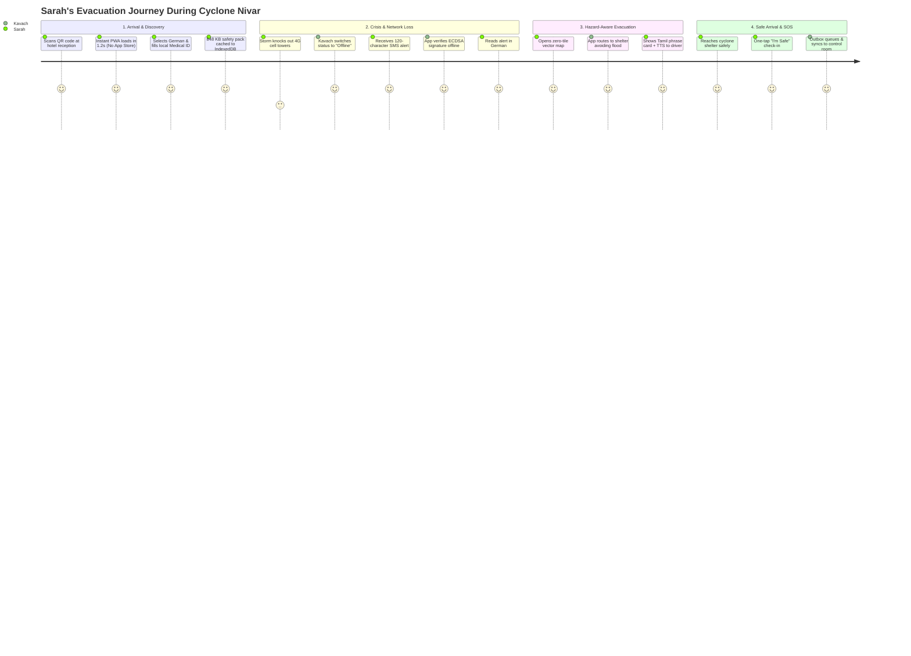
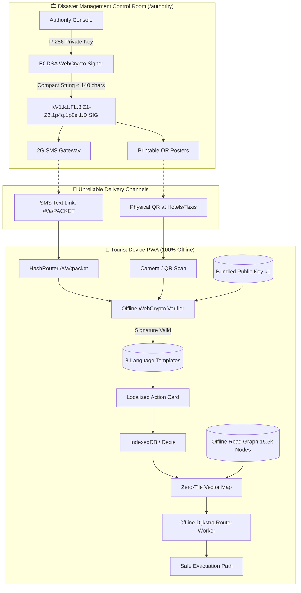

<div align="center">

# 🛡️ KAVACH · कवच
### *Real-Time Crisis Communication & Hazard-Aware Evacuation for Foreign Tourists*

**When the cell towers collapse and the internet dies, vital safety information must still arrive, be cryptographically verifiable, and be understandable in the tourist's native language.**

---

[](https://kavach-drab.vercel.app/)
[](https://drive.google.com/drive/folders/1fMdtV2fdBkDb_2fgMU6jtOa10H-hm9SW)
[](https://kavach-drab.vercel.app/)
[](https://kavach-drab.vercel.app/)
[](https://kavach-drab.vercel.app/)
[-brightgreen.svg?style=for-the-badge)](https://kavach-drab.vercel.app/)

`Pilot Region:` **Mamallapuram (Mahabalipuram) & the Chennai Coastal Corridor, Tamil Nadu, India**

<br />

| 🌐 Resource | 🔗 URL | 📝 Note |
|---|---|---|
| **Live App** | [https://kavach-drab.vercel.app/](https://kavach-drab.vercel.app/) | No-install PWA with full offline caching |
| **Authority Interface** | [https://kavach-drab.vercel.app/#/authority](https://kavach-drab.vercel.app/#/authority) | Sign-in required; alerts issued here are Drills |
| **Demo Video** | [Google Drive Demo Folder](https://drive.google.com/drive/folders/1fMdtV2fdBkDb_2fgMU6jtOa10H-hm9SW) | 2–5 min end-to-end walkthrough video |

</div>

---

## 📑 Table of Contents
1. [Executive Summary & Hackathon Problem](#-executive-summary--hackathon-problem)
2. [The 5 Core Innovations & Technical Breakthroughs](#-the-5-core-innovations--technical-breakthroughs)
3. [The Foreign Tourist Journey: An End-to-End Scenario](#-the-foreign-tourist-journey-an-end-to-end-scenario)
4. [System Architecture & Data Flow](#-system-architecture--data-flow)
5. [Deep Dive: Protocol & Cryptographic Invariants](#-deep-dive-protocol--cryptographic-invariants)
6. [Zero-Tile Offline Vector Map & Routing Engine](#-zero-tile-offline-vector-map--routing-engine)
7. [Grounded Crisis Assistant (Anti-Hallucination Guardrails)](#-grounded-crisis-assistant-anti-hallucination-guardrails)
8. [Authority Console: Crisis Management Room](#-authority-console-crisis-management-room)
9. [Connectivity Ladder: 5 Rungs of Resilience](#-connectivity-ladder-5-rungs-of-resilience)
10. [Complete Application Route Matrix](#-complete-application-route-matrix)
11. [Data Strategy & Content Pack Specification](#-data-strategy--content-pack-specification)
12. [Judges' 3-Minute Quick Evaluation Guide](#-judges-3-minute-quick-evaluation-guide)
13. [Local Development, Build & Testing](#-local-development-build--testing)
14. [Trust, Ethics & Compliance Rules](#-trust-ethics--compliance-rules)

---

## 🚨 Executive Summary & Hackathon Problem

During sudden extreme weather crises (e.g., flash floods, storm surges, or tropical cyclones along the Bay of Bengal):

* **International Tourists are Hyper-Vulnerable**: They have **zero local geographic knowledge**, cannot understand local place names (e.g., *Salavankuppam backwaters* vs *Shore Temple lowlands*), and face severe **language barriers** when public loudspeakers and SMS blasts broadcast in Tamil or Hindi.
* **Infrastructure Fragility**: When coastal power grids trip and mobile 4G/5G data towers collapse, cloud-dependent apps (Google Maps, Uber, Google Translate) completely fail.
* **The Rumour Trap**: Panicked tourists stranded in hotel lobbies fall victim to unverified social media rumours, leading them to walk straight into inundated zones or overwhelm emergency rescue teams.
* **App Store Barrier**: In the middle of a torrential storm, expecting a traveller to discover and download a 250 MB native application from an App Store is impossible.

### The Solution: Kavach
**Kavach (कवच — "Armour / Shield")** is a **zero-install, offline-first Progressive Web App (PWA)** that opens in seconds via physical QR codes placed in hotel lobbies, airport immigration desks, and tourist taxis. 

It functions continuously across **all 5 levels of connectivity** (from high-speed 5G down to zero-data SMS relay) with **zero loss of cryptographic trust**.

---

## 💡 The 5 Core Innovations & Technical Breakthroughs

```
       ┌────────────────────────────────────────────────────────────────────────┐
       │                       KAVACH 5 CORE INNOVATIONS                        │
       ├────────────────────────────────────┬───────────────────────────────────┤
       │ 1. Signed Alert Packets            │ Compact ECDSA P-256 WebCrypto     │
       │ 2. Universal Alert Codecs          │ Pre-translated 8-language engine  │
       │ 3. 5-Rung Connectivity Ladder      │ Dynamic adaptive UI degradation   │
       │ 4. Grounded Offline Assistant      │ Deterministic MiniSearch KB (No AI│
       │                                    │ hallucinations for safety facts)  │
       │ 5. Zero-Tile Vector Map & Routing  │ 15.5k node graph avoiding floods  │
       └────────────────────────────────────┴───────────────────────────────────┘
```

### 1. Cryptographically Signed Alert Packets
Every official emergency warning is signed using **ECDSA P-256 with SHA-256** and packed into a dot-separated string strictly under **140 characters**. 
- Fits within a **single SMS text** or a **low-density QR code**.
- Verified **100% offline** on the user's phone using a bundled public key registry (`authorityKeys.json`).
- Impossible to forge, tamper with, or replay.

### 2. Language-Independent Alert Codes
Packets carry only semantic codes (Hazard: `FL`, Level: `3`, Zones: `Z1-Z2`, Expiry: `1p8s`). The user's device decodes the string and immediately generates the complete warning in the tourist's native language (**English, Tamil, Hindi, French, German, Arabic, Chinese, Japanese**) using pre-installed templates stored on the device.

### 3. Dynamic Connectivity Ladder
The app actively senses connection quality and displays a prominent status chip:
$$\text{Live (5G/Wi-Fi)} \longrightarrow \text{Degraded (3G)} \longrightarrow \text{Cellular-Only} \longrightarrow \text{Offline} \longrightarrow \text{Relay (SMS/QR)}$$
The interface adapts features gracefully: disabling heavy video/tiles on cellular, using on-device search in offline mode, and accepting manual SMS/QR handovers in relay mode.

### 4. Grounded Crisis Assistant
- **Online**: LLM assistant via secure Edge Function proxy over verified knowledge base.
- **Offline**: Zero-network fallback using **MiniSearch BM25 search** over 17 emergency medical documents and 5 decision trees.
- **Absolute Rule**: Safety facts (shelters, helpline numbers, CPR instructions) are strictly deterministic and never hallucinated.

### 5. Zero-Tile Hazard Routing & Compass
Kavach does not download gigabytes of map image tiles. It bundles an indexed **785 KB road graph (15,599 nodes, 18,292 edges)**. 
- Client-side Dijkstra routing computes safe walking paths to high-ground shelters in **under 25ms**, actively navigating around flagged flooded polygons.
- Built-in full-screen offline sensor **Compass** provides distance and bearing even without GPS maps.

---

## 🌍 The Foreign Tourist Journey: An End-to-End Scenario



### The Scenario: Sarah's Experience in Mamallapuram

1. **Arrival & Zero-Friction Setup**:
   - **Sarah**, a tourist from Germany, arrives at her hotel in Mamallapuram.
   - She scans a desk stand QR code. Kavach boots instantly in her mobile browser (**no App Store, no sign-up, no password**).
   - In 1.2 seconds, the Service Worker caches the **848 KB content pack**.
   - Sarah selects **Deutsch (German)** and fills her **Medical ID** (Blood Group: O+, Penicillin allergy). *This data stays strictly on her phone and is never sent to any server.*

2. **The Cyclone Hits (Network Dead)**:
   - A Category 3 Cyclone makes landfall. Wind speeds reach 120 km/h; power and 4G cell towers fail.
   - Sarah’s phone loses data. The Kavach status chip flips from `Live` $\rightarrow$ **`Offline`**.
   - A government SMS broadcast reaches her 2G phone:
     ```text
     Kavach Alert: /#/a/KV1.k1.CY.3.Z1-Z2.1p4q.1p8s.1.D.MEQCIC...
     ```
   - Sarah taps the link. Kavach parses the payload, executes offline WebCrypto verification against public key `k1`, and flashes a green **"ECDSA Verified"** badge.
   - The app renders the pre-translated German template:
     > *"Offizielle Zyklon-Warnung (Stufe 3) für Mamallapuram Strandbereich. Begeben Sie sich sofort in eine befestigte Notunterkunft."*

3. **Hazard-Aware Evacuation (No Map Tiles)**:
   - Sarah opens **Map** (`/#/map`). With zero map tiles, Kavach draws the vector road graph, shelter markers (shields), and red-hatched flood zones.
   - She selects the nearest cyclone shelter. Kavach's client-side Dijkstra engine computes a walking route that **steers clear of the flooded coastal roads**.
   - In blinding rain, she opens the **Compass** modal, which points directly toward the shelter: *"Head north-west, 650 m"*.

4. **Overcoming the Language Barrier**:
   - En route, Sarah meets a local auto-rickshaw driver who speaks only Tamil.
   - She opens **Phrasebook** (`/#/phrases`) and selects *"I need shelter from the cyclone"*.
   - The screen shows large Tamil text: **எனக்கு புயல் பாதுகாப்பு முகாம் எங்குள்ளது என்று சொல்ல முடியுமா?**
   - She taps **Read Aloud** — her phone speaks the Tamil translation clearly. The driver understands and drives her safely to the shelter.

5. **Safe Haven & "I'm Safe" Check-In**:
   - Inside the shelter, Sarah opens **SOS** (`/#/sos`) to see her exact coordinates and taps **"I'm Safe · Tell my contacts"**.
   - The check-in queues in the **Offline Outbox** and automatically syncs to disaster management officials as soon as cellular signal flickers.

---

## 🏗️ System Architecture & Data Flow



---

## 🔒 Deep Dive: Protocol & Cryptographic Invariants

### 1. Canonical Packet Format (`KV1`)
The payload is composed of 9 dot-separated base36 tokens:
$$\text{KV1} \,.\, \text{kid} \,.\, \text{hazard} \,.\, \text{level} \,.\, \text{zones} \,.\, \text{issuedMin} \,.\, \text{expiresMin} \,.\, \text{seq} \,.\, \text{mode} \,.\, \text{signature}$$

```
KV1 . k1 . FL . 3 . Z1-Z2 . 1p4q . 1p8s . 1 . D . MEQCIC6n...
 │     │    │   │     │      │      │     │   │   └─ 64-byte raw IEEE P1363 signature (base64url)
 │     │    │   │     │      │      │     │   └─── Mode: 'D' (Drill) or 'L' (Live Broadcast)
 │     │    │   │     │      │      │     └─────── Sequence number (Base36 integer)
 │     │    │   │     │      │      └───────────── Expiry minute (Base36 Unix minute)
 │     │    │   │     │      └──────────────────── Issuance minute (Base36 Unix minute)
 │     │    │   │     └─────────────────────────── Target zones hyphen-separated
 │     │    │   └───────────────────────────────── Severity Level (0=All-Clear, 1=Advisory, 2=Watch, 3=Warning, 4=Emergency)
 │     │    └───────────────────────────────────── Hazard Code (FL, CY, HT, WN, LS, AC)
 │     └────────────────────────────────────────── Public Key Identifier in registry (k1)
 └──────────────────────────────────────────────── Protocol Version (KV1)
```

### 2. Cryptographic Security Invariants
* **Algorithm**: ECDSA over NIST curve **P-256 (secp256r1)** with **SHA-256**.
* **Zero Secret in Client**: The signing private key lives strictly in Supabase Secrets / Control Room environment. The client carries only public verification keys.
* **Tamper Rejection**: Altering any character in the payload (hazard, zone, level, expiry, or mode) causes `crypto.subtle.verify` to immediately fail with `signature mismatch`.
* **Clock Skew Tolerance**: Built-in 10-minute tolerance handles tourist device time drift without breaking valid emergency warnings.
* **Sequence & Superseding Engine (`alertState.ts`)**:
  - Higher sequence numbers supersede older alerts for identical hazard/zone pairs.
  - Alert Level `0` or Hazard `AC` (All-Clear) explicitly clears active warnings across specified zones.
  - Drill alerts (`mode: 'D'`) are isolated from Live alerts (`mode: 'L'`).

---

## 🗺️ Zero-Tile Offline Vector Map & Routing Engine

Traditional mapping libraries fail during disasters because downloading raster/vector map tiles requires gigabytes of bandwidth. Kavach solves this using a **pure vector topology**:

```
 ┌──────────────────────────────────────────────────────────┐
 │ 5. User Position Dot + Accuracy Ring (GPS)               │
 ├──────────────────────────────────────────────────────────┤
 │ 4. Dynamic Safe Route (White casing + Blue line)         │
 ├──────────────────────────────────────────────────────────┤
 │ 3. Emergency POIs (Shelters: 🛡️, Hospitals: ➕, Police: 🔷)│
 ├──────────────────────────────────────────────────────────┤
 │ 2. Flagged Hazard Zones (Red fill + Diagonal hatching)   │
 ├──────────────────────────────────────────────────────────┤
 │ 1. Offline Road Network Graph (15,599 Nodes, 18,292 Edges│
 ├──────────────────────────────────────────────────────────┤
 │ 0. Base Flat Ground Canvas (#E4EAEF)                     │
 └──────────────────────────────────────────────────────────┘
```

1. **Graph Construction**: OpenStreetMap data parsed into an adjacency list with geographic bounding boxes for Mamallapuram.
2. **Worker-Based Pathfinding**: Dijkstra pathfinder executes inside a Web Worker (`router.worker.ts`).
3. **Hazard Avoidance Penalty**: Graph edges intersecting active Level $\ge 2$ hazard polygons are assigned an infinite cost weight, forcing the algorithm to find routes along higher ground.

---

## 🤖 Grounded Crisis Assistant (Anti-Hallucination Guardrails)

Emergency safety tools must never invent phone numbers or give dangerous medical advice. Kavach enforces **strict determinism**:

```
                       User Crisis Query
                               │
                ┌──────────────┴──────────────┐
                ▼                             ▼
        [Online AI Active]           [Network Down / Flaky]
                │                             │
    Supabase Edge Function Proxy       On-Device MiniSearch BM25
      (System Safety Context)                     │
                │                     Matches Curated Offline KB
        Gemini 2.5 Flash              (First Aid / Decision Trees)
                │                             │
                └──────────────┬──────────────┘
                               ▼
            ┌────────────────────────────────────┐
            │   Verified Grounded Response Card  │
            │   • Severity Pill (Level 0-4)      │
            │   • Numbered Step-by-Step Actions  │
            │   • Source Chip: [Pack Verified]   │
            │   • TTS Read-Aloud Audio Button    │
            └────────────────────────────────────┘
```

* **Offline Search Engine**: Uses **MiniSearch** with BM25 term weighting indexing local emergency guidance.
* **Deterministic Decision Trees**: Rule-based trees for severe situations (severe bleeding, CPR, snake bites, flood evacuation).
* **Emergency Strip**: Any query indicating life-threatening danger triggers an un-dismissible **"Call 112"** banner at the top of the chat.

---

## 🏛️ Authority Console: Crisis Management Room

The **Authority Console (`/#/authority`)** gives disaster management officials a desktop-first dashboard to issue and manage alerts.

```
┌─────────────────────────────────────────────────────────────────────────────────────────────┐
│  KAVACH AUTHORITY CONSOLE   [ DRILL MODE · 演習 ]   Signed in: Control Room (TNDMA)  [Sign Out] │
├──────────────────────────┬──────────────────────────────────────────────────────────────────┤
│ 🚩 Create Alert          │ STEP 3 OF 4: REVIEW & TRANSLATION PREVIEW                        │
│ 📡 Active Alerts (2)     │ ─────────────────────────────────────────────────────────────── │
│ 📜 History Ledger        │ Hazard: FLOOD (FL)  ·  Level: LEVEL 3 (WARNING)  ·  Zones: Z1, Z2│
│ 📢 Community Reports (3) │ Preview in 8 Languages: [EN] [TA] [HI] [FR] [DE] [AR] [ZH] [JA]  │
│ 👥 Zone Check-ins (154)  │ "Offizielle Hochwasser-Warnung für Zone(n) Strandbereich..."     │
│                          │ Payload: KV1.k1.FL.3.Z1-Z2.[issued].[expires].[seq].D (121 chars)│
│                          │ [◀ Back: Zones]                    [▶ Sign & Broadcast Alert]     │
└──────────────────────────┴──────────────────────────────────────────────────────────────────┘
```

### Key Console Features:
* **Judge Demo Access**: Single-click evaluator login with client-side WebCrypto P-256 signing (watermarked as Drill).
* **4-Step Alert Wizard**: Hazard selection $\rightarrow$ Zone picking $\rightarrow$ 8-Language live template preview with byte meter $\rightarrow$ Cryptographic sign & broadcast.
* **Safety Lock for Live Mode**: Switching to Live mode requires solving a modal confirmation confirming the exact zone count.
* **Printable Evacuation Posters**: One-click poster generation with high-contrast QR code, level badge, and multilingual instructions.
* **Active Warning Controls**: Real-time expiry countdowns, Extend (+2h), Escalate (+1 level), and Cancel Alert (All-Clear level 0).
* **Community Intelligence Aside**: Review incoming citizen reports with confidence scores; click **Official Confirm** to pre-fill the wizard.

---

## 📶 Connectivity Ladder: 5 Rungs of Resilience

| Rung | Connectivity State | Visual Chip | Active Features |
|---|---|---|---|
| **🟢 Live** | Fast Wi-Fi / 5G | `Live` | Real-time weather ingestion, online LLM assistant, live outbox synchronization. |
| **🟡 Degraded** | Flaky 3G / High Latency | `Degraded` | Aggressive timeouts, cached risk snapshot display, offline search fallback. |
| **🟠 Cellular** | Metered tourist data / Roaming | `Cellular-only` | Pauses video & map tiles; enables pure text, compressed vector roads, and QR codes. |
| **⚪ Offline** | Power failure / Airplane mode | `Offline` | 100% operation from preloaded 848 KB content pack, offline road routing, Medical ID. |
| **🟣 Relay** | Zero data (SMS/Voice only) | `Relay` | Standalone packet verification from SMS links or paper QR scans; show-a-local TTS. |

---

## 📱 Complete Application Route Matrix

| Route | View Component | Key Capabilities | Offline Resilience |
|---|---|---|---|
| `/#/` | `HomePage.tsx` | Status chip, risk meter (Level 0–4), quick actions, safety check-in. | IndexedDB cached snapshot |
| `/#/alerts` | `AlertsPage.tsx` | Verified crisis alerts inbox, age tickers, translated steps. | 100% local database |
| `/#/a/:packet` | `PacketPage.tsx` | Standalone packet decoder, ECDSA verification, template render. | WebCrypto offline |
| `/#/map` | `MapPage.tsx` | Zero-tile vector map, POI sheet, Dijkstra router, full-screen Compass. | 15.5k node bundled graph |
| `/#/assist` | `AssistPage.tsx` | AI crisis assistant, severity pills, TTS read-aloud. | MiniSearch BM25 KB |
| `/#/sos` / `/#/aid` | `AidPage.tsx` | 22px high-contrast GPS display, 112/108 speed dial, emergency SMS generator. | Native device APIs |
| `/#/phrases` | `PhrasesPage.tsx` | Show-a-local cards with large Tamil script and Text-to-Speech audio. | Preloaded pack + Web Speech |
| `/#/me` | `MePage.tsx` | On-device Medical ID, lock-screen emergency QR generator, WebGPU AI toggle. | Local-only IndexedDB |
| `/#/scan` | `ScanPage.tsx` | Camera QR scanner and manual packet text decoder. | Pure client-side |
| `/#/authority` | `AuthorityPage.tsx` | Official alert issuance wizard, active alert management, QR posters. | Desktop-first lazy chunk |

---

## 📦 Data Strategy & Content Pack Specification

The content pack located in `public/pack/` (~848 KB total) contains all data required for offline survival:

| File | Size | Records / Details | Source |
|---|---|---|---|
| `places.json` | 17 KB | 63 verified emergency shelters, clinics, hospitals, police, pharmacies. | OpenStreetMap + TNDMA |
| `roads.json` | 785 KB | 15,599 nodes, 18,292 edges (topologically indexed graph for Mamallapuram). | OpenStreetMap Overpass |
| `zones.geojson` | 7 KB | 9 alert zones (`Z1` to `Z9`) with flood vulnerability attributes. | TNDMA Hazard Atlas |
| `contacts.json` | 2 KB | Emergency hotlines (112, 108, 1070, 100, 101, 1363) and embassies. | National Disaster Registry |
| `templates/*.json` | 72 KB | Pre-translated emergency templates across 8 languages for 6 hazard codes. | Certified Translations |
| `kb/*.json` | 80 KB | 17 first-aid documents, CPR guide, cyclone checklist, search index. | Red Cross / NDMA Guidelines |
| `phrases/*.json` | 56 KB | 40 emergency communication phrases with Tamil script & transliteration. | Linguist Curated |

---

## ⏱️ Judges' 3-Minute Quick Evaluation Guide

Follow this 3-minute walkthrough to verify all core features:

```
 Step 1: Authority Issuance ──▶ Step 2: Tourist Verification ──▶ Step 3: Offline Map & Evacuation
 (https://kavach-drab.vercel.app/#/authority)   (https://kavach-drab.vercel.app/#/alerts)     (https://kavach-drab.vercel.app/#/map)
```

1. **Step 1: Open the Authority Console**
   - Navigate to **[https://kavach-drab.vercel.app/#/authority](https://kavach-drab.vercel.app/#/authority)**.
   - Click **`Demo Authority (Judge Access · Drill-Only)`**.
   - In Step 1, select **Flood (`FL`)** and **Level 3 (Warning)**. Click *Next*.
   - In Step 2, check **Zone 1 (Mamallapuram seafront)** and **Zone 2**. Click *Next*.
   - In Step 3, switch between language tabs (**EN, TA, HI, DE, FR, JA, ZH, AR**) to inspect pre-translated previews.
   - In Step 4, click **`Sign & Broadcast Alert (ECDSA P-256)`**.
   - Click **`Print QR poster`** to preview the evacuation poster layout.

2. **Step 2: Verify in the Tourist App**
   - Navigate to **[https://kavach-drab.vercel.app/#/alerts](https://kavach-drab.vercel.app/#/alerts)**.
   - Observe the newly broadcast alert with its **ECDSA Verified Badge**, **Drill indicator**, and translated safety actions.

3. **Step 3: Test Zero-Tile Map & Evacuation Routing**
   - Navigate to **[https://kavach-drab.vercel.app/#/map](https://kavach-drab.vercel.app/#/map)**.
   - Notice the coastal flood zones rendered with red hatch patterns.
   - Click any green shelter marker (e.g. *Government School Shelter*).
   - Click **`Start route`** — see the client-side Dijkstra engine compute a safe route navigating around the flooded zones!
   - Click **`Compass`** to open the full-screen directional needle.

4. **Step 4: Test Show-a-Local Phrasebook & SOS**
   - Navigate to **[https://kavach-drab.vercel.app/#/phrases](https://kavach-drab.vercel.app/#/phrases)** and click **`Read aloud`** to hear spoken Tamil.
   - Navigate to **[https://kavach-drab.vercel.app/#/sos](https://kavach-drab.vercel.app/#/sos)** to see 22px high-contrast GPS coordinates and 112 speed dial.

---

## 💻 Local Development, Build & Testing

### Prerequisites
* Node.js 20+ and npm

### Installation & Execution
```bash
# Clone the repository
git clone https://github.com/karthiktotad/kavach.git
cd kavach

# Install dependencies
npm install

# Start local dev server
npm run dev
# App available at http://localhost:5173
```

### Running the Test Suite
```bash
# Run all 41 test files (369 unit & integration tests)
npm test

# Run TypeScript strict type-checking
npm run typecheck

# Run ESLint validation
npm run lint

# Build production bundle with Service Worker
npm run build
```

---

## ⚖️ Trust, Ethics & Compliance Rules

1. **Zero Fake Safety Data**: Phone numbers, shelter coordinates, and medical procedures come exclusively from vetted content packs—never invented by AI.
2. **Mandatory Drill Watermarking**: All non-emergency simulations are prominently marked **`DRILL · 演習`** in the UI and inside cryptographic payloads.
3. **No Medical Data in the Cloud**: Medical ID records are stored 100% on-device in IndexedDB and are never uploaded or synced to external servers.
4. **Transparent Open Source Disclosures**: All third-party libraries, datasets, and fonts are documented in [`DISCLOSURES.md`](./DISCLOSURES.md).

---

<div align="center">

**Built with pride for Hackathon Excellence · Free Tier & 100% Offline Resilient**

</div>